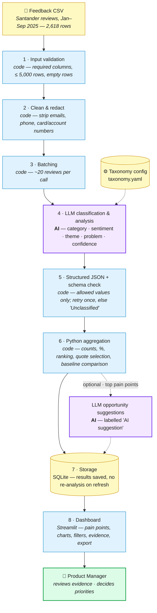

# AI Architecture & Decision Log — AI Customer Intelligence Platform

> **Status:** Draft v0.1 · Covers challenge Part 4.
> Builds on the [Business Requirements Document](ai-customer-intelligence-platform-02-business-requirements-document.md).

---

## 1. System Architecture



*Static image version: [architecture diagram (PNG)](ai-customer-intelligence-platform-03-architecture-diagram.png)*

**Key:** 🟪 purple = AI (LLM) · 🟦 blue = deterministic code · 🟨 yellow = data / config ·
🟩 green = human decision.

Only **two** boxes use AI. Everything that produces a number, a ranking, a
chart or a quote is ordinary code.

---

## 2. Components

| # | Component | Type | What it does | Requirement |
|---|---|---|---|---|
| 1 | Input validation | Code | Checks required columns (`feedback`, `date`), file ≤ 2,000 rows / 5 MB, drops empty rows and reports how many and why | FR-01, FR-02 |
| 2 | Clean & redact | Code | Regex removal of emails, phone numbers and 8+ digit card/account-number patterns; trims whitespace | FR-03 |
| 3 | Batching | Code | Groups reviews into batches of ~20, each with its row ID | AI req: response time |
| 4 | LLM classification & analysis | **AI** | For each review returns `category` (main issue), `other_categories` (up to 3), `sentiment`, `theme`, `problem`, `confidence`, using the taxonomy loaded from `taxonomy.yaml` | FR-04 – FR-07, FR-16 |
| 5 | Schema check | Code | Validates every object with a Pydantic model: allowed category/sentiment values, every input ID returned exactly once. Invalid → retry batch once → otherwise mark `Unclassified` | AI req: failure handling |
| 6 | Aggregation | Code | pandas: counts and % by category, sentiment, theme and app version; pain-point ranking; picks 3+ real quotes per pain point by row ID; side-by-side with the old topic model | FR-08 – FR-10 |
| 7 | Storage | Code | SQLite: one table of labelled reviews, one of run metadata (file, model, prompt version, timings, failures) | NFR: reliability |
| 8 | Dashboard | Code | Streamlit + Plotly: top pain points, charts, filters, click-through evidence, CSV export | FR-11, FR-12, FR-14, FR-15 |
| – | Opportunity suggestions *(optional)* | **AI** | Given the top 5 pain points and their quotes, suggests up to 5 opportunities, each tied to a pain point, labelled "AI suggestion" | FR-13 |

### 2.1 LLM output contract

Each batch returns a JSON array, one object per input review:

```json
{
  "id": 1042,
  "category": "Login & Access",
  "other_categories": ["App Updates & Stability"],
  "sentiment": "negative",
  "theme": "login hangs after security code",
  "problem": "Customer cannot reach their accounts because login stalls after entering the security number.",
  "confidence": 0.92
}
```

- `category` ∈ the 12 taxonomy values; `sentiment` ∈ {positive, negative, neutral, mixed}
- `problem` is `null` for positive/neutral reviews
- The model never returns review text — quotes are looked up from the original file by `id`

### 2.2 Prompt structure

1. Role and task: *"You label customer reviews of a banking app. Label only what the customer says."*
2. The taxonomy — each category with a one-line definition and one real example (from `taxonomy.yaml`)
3. Sentiment definitions, including *mixed* (praise and complaint in one review)
4. Rules: one main category (most words or anger) plus up to 3 other issues; specific praise goes to the aspect praised; very short reviews still get a category; never invent categories
5. The batch of reviews as `id: text` pairs
6. Required JSON schema

The prompt is stored as a versioned file (`prompts/classify_v2.txt`; v1 kept for comparison). Every
run records which prompt version and model produced it, so evaluation
results can be traced to an exact configuration.

### 2.3 Expected volume and cost (full working dataset)

| Item | Estimate |
|---|---|
| Reviews (Santander, Jan–Sep 2025) | 2,618 |
| Batches of 20 | 131 |
| Input tokens (prompt ~1,500 × 131 + review text ~60k) | ~260,000 |
| Output tokens (~50 per review) | ~130,000 |
| **Total for the full dataset** | **~390,000 tokens** |

At current small-model pricing this is well under £1 for the whole
dataset — comfortably within the £1 per 1,000 reviews target. *(Exact £
figure to be confirmed against the chosen provider's price list at build
time.)*

---

## 3. Decision Log

| # | Decision | Alternative(s) considered | Why we selected it |
|---|---|---|---|
| D1 | **Use an LLM for classification, sentiment and theme extraction** | Keyword rules; the existing topic model; training a classifier | The existing topic model left 47% of low-star reviews unclassified. Rules miss paraphrases ("it just sits doing nothing" = login failure). Training a classifier needs thousands of labelled examples we don't have. An LLM handles varied language with no training data. |
| D2 | **Deterministic code for counts, %, ranking, charts and quote selection** | Ask the LLM to summarise and count | LLMs can miscount and give different numbers on each run. Code is exact, repeatable, instant and free. A PM must be able to trust that "62 login complaints" really is 62. |
| D3 | **Structured JSON output, validated against a schema** | Free-text LLM responses | Downstream analytics need predictable fields. A schema lets code reject bad output automatically instead of a human spotting it. |
| D4 | **Controlled taxonomy (fixed 12 categories) + free-text theme** | Let the LLM invent categories per run | Fixed categories make results comparable month to month and measurable against an evaluation set. The free-text theme still lets new, unexpected problems surface. |
| D5 | **Taxonomy stored in a config file (`taxonomy.yaml`)** | Hard-code categories in the prompt/code | Product Ops can update categories without a developer; the same platform can be pointed at another product or domain by swapping config and data. |
| D6 | **Batch ~20 reviews per LLM call** | One call per review; all reviews in one call | One-per-review is ~20× more calls (slow, costly, rate-limit risk). One giant call risks the model skipping or mixing up rows and fails all-or-nothing. 20 balances speed, cost and accuracy; a failed batch only affects 20 rows. |
| D7 | **Main category + up to 3 secondary categories per review** *(revised 30 Oct after labelling the eval set — originally single-label)* | Single-label only; unlimited multi-label | Labelling real reviews showed many raise several issues (e.g. login loop + crash + scam worry). Single-label hid real complaints from the ranking. Keeping one *main* category preserves a clear headline per review and simple accuracy scoring; secondary categories make every raised issue count. Capped at 3 to stop the model tagging every word. Evaluated separately (secondary recall and precision). |
| D8 | **Model: a small, low-cost hosted LLM (e.g. Claude Haiku or GPT-mini class), upgrade only if evaluation fails** | Largest frontier model; self-hosted open-source model | Classification into 12 known categories is a relatively easy task, so start with the cheapest fast model and let the evaluation set decide. If category accuracy is < 85%, try a larger model and record the cost/accuracy trade-off. Self-hosting adds infrastructure work with no MVP benefit. *Final model choice to be confirmed at build.* |
| D9 | **Versioned prompts; repeatability measured, not assumed** *(revised 31 Oct: originally "temperature 0")* | Default settings, prompt edited in place | Same input should give the same labels, so results can be traced to an exact prompt and model. The current Anthropic SDK no longer accepts a temperature setting, so repeatability is checked by the evaluation instead: duplicate reviews must get identical labels, and every run records model + prompt version. First real run: duplicates 100% consistent. |
| D10 | **Redact personal data with code before the LLM call** | Send raw text; ask the LLM to ignore personal data | Data should never reach a third party in the first place. Regex is predictable and auditable; an instruction to "ignore" data doesn't stop it being sent. |
| D11 | **Quotes looked up by row ID, never generated by the LLM** | Ask the LLM for "example quotes" | Prevents fabricated or paraphrased evidence. Every quote a PM sees is guaranteed to be a real customer's words. |
| D12 | **Python + pandas** | JavaScript/Node | Python is the standard for data work, pandas does the aggregation in a few lines, and the challenge's suggested repo uses `requirements.txt`. |
| D13 | **Streamlit for the dashboard** | React/Next.js front end; BI tool (Power BI, Looker) | Builds an interactive data app in pure Python in days, not weeks. A custom front end is unnecessary for an MVP; a BI tool can't run the LLM pipeline or be shared as a live demo. |
| D14 | **SQLite for storage** | Postgres; no storage (recompute each time) | Zero setup, a single file, enough for thousands of rows. Saving results means a page refresh never re-runs (and re-pays for) the analysis. Postgres is the upgrade path if multi-user is added. |
| D15 | **Deploy on Streamlit Community Cloud** | Railway; Hugging Face Spaces | Free, deploys straight from GitHub, built for Streamlit apps — gives a live link for the portfolio. Railway (already used for other projects) is the fallback if limits are hit. |
| D16 | **Keep the old topic-model labels only for comparison** | Feed them into the LLM as hints; ignore them | Feeding them in would bias the LLM towards a model we're trying to beat. Keeping them aside gives an honest, measurable baseline. |
| D17 | **Main issue chosen by outcome: the task the customer was trying to do that went wrong** *(added 31 Oct after the first eval run; replaces "most words or anger")* | Most words or anger (prompt v2); by cause (what broke in the app) | The first eval run (prompt v2) scored 80% on category, but 7 of the 10 misses were the AI choosing a different *main* issue from the human, not missing the issue (lenient score 94%). The human labels mixed two rules: E10 was labelled by outcome ("can't send money" → Payments), E14 by cause ("app keeps stopping" → Stability). Outcome was chosen because the product ranks **customer pain points**: a PM needs to know customers can't log in or pay, and the cause still counts as a secondary issue, so engineering sees it too. Cause categories (Stability, Performance, Design, Missing Feature) are main only when no task is named. Implemented in prompt v3 and taxonomy v3; 6 eval labels changed to follow it (see `evals/labelling-log.md`). |


### 3.1 Decision history

A dated record of when decisions were made or changed, who made them, and the evidence. New decisions and revisions are added here as well as in the table above.

| Date | Decision | Change | Decided by | Evidence |
|---|---|---|---|---|
| 30 Oct 2026 | D1–D16 | Initial architecture decisions | Tez | Brief, BRD, dataset profiling |
| 30 Oct 2026 | D7 | Single-label → main + up to 3 secondary categories | Tez | Labelling the eval set: 20 of 50 reviews raised several issues |
| 31 Oct 2026 | D9 | "Temperature 0" → repeatability measured by the eval | Tez | Anthropic SDK 2.x removed the temperature setting; duplicates 100% consistent in the first run |
| 31 Oct 2026 | D17 | Main issue chosen by outcome, not "most words or anger" | Tez | First eval run: 7 of 10 category misses were main-vs-secondary swaps; human labels mixed outcome and cause |
| 31 Oct 2026 | D6 | Batches of ~20 now sent **in parallel** (5 at once) instead of one after another (CR-12) | Tez | Full run took ~30 min against an 8-min target; now 6.1 min. Two full runs agreed on 95.5% of main categories and 98.8% of sentiments, so repeatability (D9) is high but not perfect |

---

## 4. Where Humans Stay in the Loop

- **Taxonomy ownership:** Product Ops/PM define and revise categories.
- **Low-confidence review:** items with confidence < 0.6 are flagged for optional human check.
- **Evaluation:** a human-labelled set of 30–50 reviews (Part 9) is the source of truth for accuracy.
- **Decisions:** the platform ranks and evidences pain points; the PM decides priorities.
  Opportunity suggestions are clearly labelled and never auto-actioned.

---

## 5. Risks Introduced by the Architecture

Carried into the risk register (Part 7):

- LLM mislabels sarcasm or mixed reviews → measured in evaluation; mixed sentiment tested explicitly in UAT.
- Provider outage or rate limits → batch retry; results saved per batch.
- Model or price changes by provider → model and prompt version recorded per run; eval re-run on any change.
- Taxonomy drift (new issue types appear) → monitor share of "Other"; review if > 10%.
