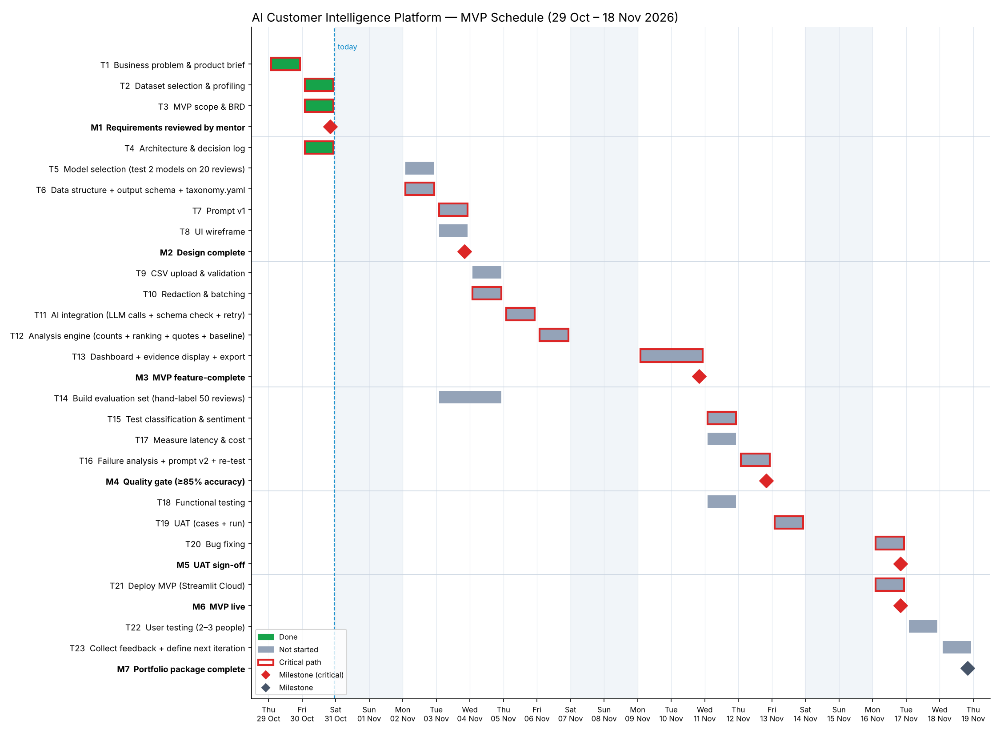

# Project Plan — AI Customer Intelligence Platform

> **Status:** Draft v0.1 · Covers challenge Parts 5 (project plan) and 6 (Gantt chart).
> Schedule data: [ai-customer-intelligence-platform-05-project-schedule.csv](ai-customer-intelligence-platform-05-project-schedule.csv) ·
> chart generated by [ai-customer-intelligence-platform-05-make-gantt-chart.py](ai-customer-intelligence-platform-05-make-gantt-chart.py).

---

## 1. Summary

| | |
|---|---|
| **Goal** | A deployed MVP that turns a CSV of app reviews into ranked, evidenced pain points, with measured AI accuracy |
| **Timeline** | Thu 29 Oct – Wed 18 Nov 2026 · 14 working days |
| **MVP live** | **Mon 16 Nov 2026** (milestone M6) |
| **Team** | Solo build — one person as PM, designer, developer and tester; mentor as reviewer |
| **Working days** | Mon–Fri; weekends shaded on the chart and not counted |

---

## 2. Phases

| Phase | Purpose | Key outputs | Dates |
|---|---|---|---|
| 1 Discovery & Requirements | Define the problem, user, data and scope | Product brief, dataset profile, BRD | 29–30 Oct ✅ |
| 2 Technical Design | Decide how it will work before building | Architecture & decision log, model choice, schema, taxonomy, prompt v1, wireframe | 30 Oct – 3 Nov |
| 3 Development | Build the MVP | Upload, validation, redaction, AI pipeline, analysis engine, dashboard | 4–10 Nov |
| 4 AI Evaluation | Prove the AI is good enough | Labelled eval set, accuracy results, failure analysis, cost/latency | 3–12 Nov |
| 5 QA & UAT | Prove the product works for the user | Functional tests, UAT results, fixes | 11–16 Nov |
| 6 Deployment | Put it in front of people | Live app, user feedback, next-iteration plan, portfolio | 16–18 Nov |

---

## 3. Gantt Chart

Red outline = critical path · ◆ = milestone · green = done · grey = not started.

---

## 4. Task Schedule

### Phase 1 Discovery & Requirements

| ID | Task | Start | End | Days | Depends on | Milestone | Status | Critical |
|---|---|---|---|---|---|---|---|---|
| T1 | Business problem & product brief | Thu 29 Oct | Thu 29 Oct | 1 | — |  | Done | ● |
| T2 | Dataset selection & profiling | Fri 30 Oct | Fri 30 Oct | 1 | T1 |  | Done | ● |
| T3 | MVP scope & BRD | Fri 30 Oct | Fri 30 Oct | 1 | T2 |  | Done | ● |
| M1 | **Requirements reviewed by mentor** | Fri 30 Oct | Fri 30 Oct | — | T3 | ◆ | In review | ● |

### Phase 2 Technical Design

| ID | Task | Start | End | Days | Depends on | Milestone | Status | Critical |
|---|---|---|---|---|---|---|---|---|
| T4 | Architecture & decision log | Fri 30 Oct | Fri 30 Oct | 1 | T3 |  | Done | ● |
| T5 | Model selection (test 2 models on 20 reviews) | Mon 02 Nov | Mon 02 Nov | 1 | T4 |  | Not started |  |
| T6 | Data structure + output schema + taxonomy.yaml | Mon 02 Nov | Mon 02 Nov | 1 | T4 |  | Not started | ● |
| T7 | Prompt v1 | Tue 03 Nov | Tue 03 Nov | 1 | T6 |  | Not started | ● |
| T8 | UI wireframe | Tue 03 Nov | Tue 03 Nov | 1 | T3 |  | Not started |  |
| M2 | **Design complete** | Tue 03 Nov | Tue 03 Nov | — | T5, T7, T8 | ◆ | Not started | ● |

### Phase 3 Development

| ID | Task | Start | End | Days | Depends on | Milestone | Status | Critical |
|---|---|---|---|---|---|---|---|---|
| T9 | CSV upload & validation | Wed 04 Nov | Wed 04 Nov | 1 | M2 |  | Not started |  |
| T10 | Redaction & batching | Wed 04 Nov | Wed 04 Nov | 1 | M2 |  | Not started | ● |
| T11 | AI integration (LLM calls + schema check + retry) | Thu 05 Nov | Thu 05 Nov | 1 | T7, T10 |  | Not started | ● |
| T12 | Analysis engine (counts + ranking + quotes + baseline) | Fri 06 Nov | Fri 06 Nov | 1 | T11 |  | Not started | ● |
| T13 | Dashboard + evidence display + export | Mon 09 Nov | Tue 10 Nov | 2 | T12, T8 |  | Not started | ● |
| M3 | **MVP feature-complete** | Tue 10 Nov | Tue 10 Nov | — | T9, T13 | ◆ | Not started | ● |

### Phase 4 AI Evaluation

| ID | Task | Start | End | Days | Depends on | Milestone | Status | Critical |
|---|---|---|---|---|---|---|---|---|
| T14 | Build evaluation set (hand-label 50 reviews) | Tue 03 Nov | Wed 04 Nov | 2 | T6 |  | Not started |  |
| T15 | Test classification & sentiment | Wed 11 Nov | Wed 11 Nov | 1 | M3, T14 |  | Not started | ● |
| T17 | Measure latency & cost | Wed 11 Nov | Wed 11 Nov | 1 | M3 |  | Not started |  |
| T16 | Failure analysis + prompt v2 + re-test | Thu 12 Nov | Thu 12 Nov | 1 | T15 |  | Not started | ● |
| M4 | **Quality gate (≥85% accuracy)** | Thu 12 Nov | Thu 12 Nov | — | T16, T17 | ◆ | Not started | ● |

### Phase 5 QA & UAT

| ID | Task | Start | End | Days | Depends on | Milestone | Status | Critical |
|---|---|---|---|---|---|---|---|---|
| T18 | Functional testing | Wed 11 Nov | Wed 11 Nov | 1 | M3 |  | Not started |  |
| T19 | UAT (cases + run) | Fri 13 Nov | Fri 13 Nov | 1 | M4, T18 |  | Not started | ● |
| T20 | Bug fixing | Mon 16 Nov | Mon 16 Nov | 1 | T19 |  | Not started | ● |
| M5 | **UAT sign-off** | Mon 16 Nov | Mon 16 Nov | — | T20 | ◆ | Not started | ● |

### Phase 6 Deployment

| ID | Task | Start | End | Days | Depends on | Milestone | Status | Critical |
|---|---|---|---|---|---|---|---|---|
| T21 | Deploy MVP (Streamlit Cloud) | Mon 16 Nov | Mon 16 Nov | 1 | M5 |  | Not started | ● |
| M6 | **MVP live** | Mon 16 Nov | Mon 16 Nov | — | T21 | ◆ | Not started | ● |
| T22 | User testing (2–3 people) | Tue 17 Nov | Tue 17 Nov | 1 | M6 |  | Not started |  |
| T23 | Collect feedback + define next iteration | Wed 18 Nov | Wed 18 Nov | 1 | T22 |  | Not started |  |
| M7 | **Portfolio package complete** | Wed 18 Nov | Wed 18 Nov | — | T23 | ◆ | Not started |  |

---

## 5. Milestones

| ID | Milestone | Date | Exit criteria |
|---|---|---|---|
| M1 | Requirements reviewed | Fri 30 Oct | Brief, BRD and architecture shared with mentor |
| M2 | Design complete | Tue 3 Nov | Model chosen, schema + taxonomy fixed, prompt v1 written, wireframe agreed |
| M3 | MVP feature-complete | Tue 10 Nov | All "Must" functional requirements work end-to-end on the 2,618-review dataset |
| M4 | **Quality gate** | Thu 12 Nov | ≥ 85% category and sentiment accuracy on the eval set, including low-star reviews |
| M5 | UAT sign-off | Mon 16 Nov | All UAT cases pass or have an agreed workaround |
| M6 | **MVP live** | Mon 16 Nov | Public link works for someone other than the builder |
| M7 | Portfolio package complete | Wed 18 Nov | Repo, docs, case study and live link ready to share |

---

## 6. Critical Path and Dependencies

**Critical path** (any delay here delays the launch):

> BRD (T3) → Architecture (T4) → **Schema & taxonomy (T6)** → Prompt v1 (T7) → **AI integration (T11)** →
> Analysis engine (T12) → Dashboard (T13) → MVP complete (M3) → Eval run (T15) →
> Failure analysis (T16) → **Quality gate (M4)** → UAT (T19) → Fixes (T20) → Deploy (T21)

**Critical dependencies to watch:**

1. **Taxonomy and output schema (T6) unlock three streams at once** — the prompt, the
   evaluation set and the analysis engine all depend on the category list being fixed.
   Changing categories after T6 means relabelling the eval set and reworking the prompt.
   → Freeze the taxonomy at M2; later changes go to v2.
2. **AI integration (T11) is the riskiest build task** — LLM API access, structured output
   and retries. If it slips, everything after it slips.
   → Do a 20-review spike during model selection (T5) so the API path is proven before T11.
3. **The quality gate (M4) is a go/no-go** — UAT should not start on an AI that hasn't met
   the accuracy bar. If accuracy is below 85% after prompt v2, options are: try a larger
   model (cost trade-off), simplify the taxonomy, or launch with the gap clearly documented.
4. **Deployment depends on UAT fixes** — a broken live link is worse than a late one.

**Planning choices that shorten the schedule:**

- **The evaluation set (T14) is built in parallel with development, not after it** (the
  brief's example sequences it after the MVP). It only depends on the taxonomy, and
  labelling *before* seeing any AI output avoids being anchored by the model's answers.
- Functional testing (T18) and cost/latency measurement (T17) run alongside the eval.
- Model selection (T5) and the UI wireframe (T8) have a day of float — they can slip
  one day without moving the launch.

---

## 7. Assumptions & Constraints

- Solo builder with roughly a full working day available each weekday.
- LLM API account and key available by Mon 2 Nov.
- Streamlit Community Cloud free tier is sufficient for a demo with a handful of users.
- Mentor review of docs happens asynchronously and does not block build tasks.
- Contingency: none built in explicitly; the 2 days after launch (T22–T23) act as a buffer
  for the portfolio milestone if launch slips.
