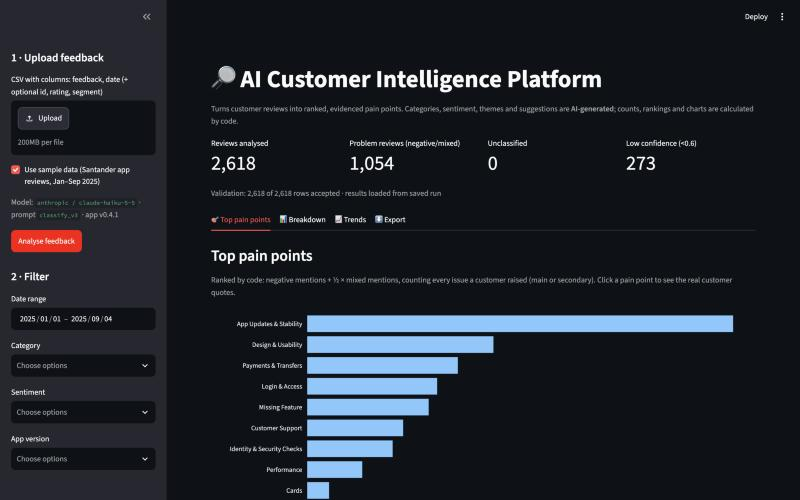
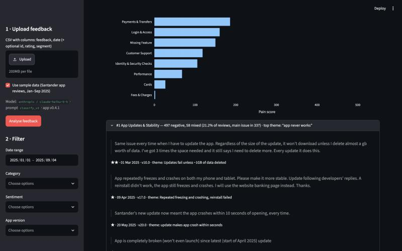
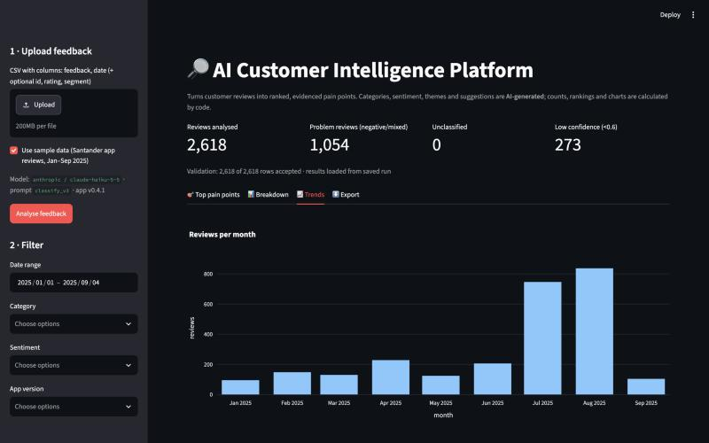

# Case Study — AI Customer Intelligence Platform

> **Status:** Draft v0.4 · 31 Oct 2026 · Covers challenge Part 11. v0.2 added the full-data run and screenshots; v0.3 UAT results; v0.4 the speed fix.
> Author: Terence Field (Tez), AI Product Manager.
> Live demo: *to come at launch* · Repo: [tezla-timemachine/ai-customer-intelligence-platform](https://github.com/tezla-timemachine/ai-customer-intelligence-platform)

**In one line:** a web app that turns a CSV of customer reviews into ranked,
evidenced pain points for a Product Manager. AI does the reading, ordinary
code does the counting, and the PM makes the decisions.

---

## 1. Problem

Product teams receive thousands of reviews, tickets and survey comments, and
read them by hand. So most feedback is never read. Tagging is inconsistent
between people. Insights arrive weeks late, and prioritisation leans on the
loudest customer instead of the most common problem.

**Problem statement:** product teams can't reliably identify, quantify and
evidence the most important customer problems in the feedback they receive.

I started from that problem, not from "let's use an LLM". The brief asks
whether AI is the right answer at all, and section 3 answers that.

## 2. User

**Primary user:** a Product Manager who owns one product area.

> *Priya, PM for the Santander mobile banking app.* Between one hundred and
> eight hundred Google Play reviews arrive each month. She needs to know
> which problems are growing, whether the latest release caused them, and
> have real quotes to make the case to engineering, without reading
> thousands of reviews first.

Head of Product, Product Ops and Customer Success can use the same
dashboard, but nothing in the MVP is built specifically for them.

## 3. AI opportunity

The hard part is **understanding language at volume**. Customers describe
the same problem in many ways ("it just sits doing nothing" means login is
broken). They mix praise with complaints, raise several issues at once, and
use sarcasm. I compared four options:

| Option | Verdict |
|---|---|
| Keep tagging by hand | Accurate in small numbers, but doesn't scale and stays inconsistent |
| Keyword rules | Cheap, but misses paraphrases, mixed feelings and sarcasm |
| Train a classifier | Needs thousands of labelled examples I didn't have |
| **LLM with a fixed list of categories** | Handles varied language with no training data, and the categories can change by editing a config file |

**The real data proved the gap.** I used 2,618 real Google Play reviews of
the Santander app from January to September 2025, from a public dataset. It
already contained labels from an older topic model, which left **47% of
low-star reviews (436 of 934) "Undefined"**. Nearly half of the reviews with
an actual problem were never classified.

## 4. Product decisions

The decisions that shaped the product most. All 17 are in the
[decision log](ai-customer-intelligence-platform-03-ai-architecture-and-decision-log.md).

- **The LLM only reads and labels. Code does every count, percentage,
  ranking and chart (D2).** LLMs can miscount and give different numbers
  each time. A PM must be able to trust that "62 login complaints" really
  is 62.
- **Quotes are looked up by row ID, never written by the AI (D11).** Every
  quote a PM sees is a real customer's words. This is the main defence
  against over-trusting the AI (risk R03).
- **A fixed list of 12 categories in a config file (D4, D5).** Results can
  be compared month to month and measured against an answer key. Product
  Ops can change the list without a developer.
- **Personal data is removed by code before anything reaches the AI
  (D10).** Telling the AI to "ignore" personal data doesn't stop it being
  sent.
- **Start with the cheapest fast model, and let the evaluation decide
  whether to upgrade (D8).** Claude Haiku passed the quality bar, so no
  upgrade was needed.
- **A main issue plus up to 3 secondary issues per review (D7).** Single
  labels hid real complaints (section 8).

## 5. Architecture

```
CSV upload
  → validate (code: columns, size, empty rows)
  → redact personal data (code: emails, phone and card numbers)
  → batches of 20 reviews
  → LLM labels: category, secondary issues, sentiment, theme, problem, confidence
  → schema check (code: allowed values only; retry once, else "Unclassified")
  → aggregate and rank (code: counts, %, real quotes)
  → SQLite (results saved, so a refresh doesn't re-run or re-pay)
  → Streamlit dashboard
  → PM decides
```

Only two steps use AI: labelling each review, and optional "AI suggestion"
product opportunities, which are clearly marked as suggestions. Everything
else is ordinary code. Diagram:
[architecture diagram](ai-customer-intelligence-platform-03-architecture-diagram.png).

**Stack:** Python, pandas, Pydantic, Streamlit, Plotly, SQLite and the
Anthropic API (claude-haiku-5-5). OpenAI and a no-AI mock mode are also
supported, so tests run without a key.

## 6. MVP

**In:** CSV upload and validation, personal-data redaction, AI labelling of
every review, top 10 pain points ranked by negative and mixed mentions, at
least 3 real quotes per pain point, filters (category, sentiment, date, app
version), charts, CSV export, and AI-suggested opportunities.

**Out, on purpose:** live integrations, user accounts, trend alerts,
competitor comparison, multi-language support, pushing tickets to Jira,
fine-tuning, and any AI making prioritisation decisions. The full list is in
the BRD.

**Top pain points**, ranked by code, from all 2,618 reviews:



**Evidence:** opening a pain point shows real customer quotes, with star rating, date, app version and the AI's theme:



**Trends:** the July 2025 jump in review volume is visible straight away, so a PM can question it:



## 7. Evaluation

I built an answer key of **50 real Santander reviews from 2024**. They were
deliberately varied, and taken from a different year than the working data,
so the AI was tested on reviews it was never tuned on. It covers every case
type in the brief: positive, negative, mixed, multiple problems, very short,
ambiguous, duplicates, sarcasm, feature requests and off-topic.

I labelled every review by hand **before** seeing any AI output, following
a written labelling guide (bias control, risk R07). The quality bar was set
in advance: **at least 85%** on category and on sentiment, including
low-star reviews on their own.

## 8. What failed

1. **The first data slice misled.** One month (August 2025) looked like a
   happy customer base: mostly 5★. Profiling showed volume jumped 4–5× in
   July and ratings flipped, probably because the app began prompting for
   ratings. I widened the data to nine months (CR-01).
2. **One label per review hid complaints.** While labelling, I found 20 of
   50 reviews raised more than one issue. With one label each, the secondary
   complaints never reached the ranking (CR-03).
3. **The first real AI run classified nothing.** The Anthropic library had
   removed a setting the code sent, so every call failed. After that fix,
   one batch was cut off mid-answer, because the model's thinking used up
   the reply budget. The safety net worked: no review was silently dropped,
   and failures showed as "Unclassified" (CR-05).
4. **The first honest score missed the bar: 80% on category.** But 7 of the
   10 misses weren't the AI misunderstanding. It had found the right issues
   and just chose a different *main* one. When I looked closer, **my own
   answer key was inconsistent.** I'd labelled "can't send money" by what
   the customer couldn't do, and "app keeps stopping, can't log in" by what
   broke.

## 9. What changed

- **One clear rule for the main issue (D17).** I chose **outcome**: the
  task the customer was trying to do that went wrong. The cause becomes a
  secondary issue. This fits a product about *customer* pain points, and
  engineering still sees the cause.
- **Prompt v3 and category definitions v3** apply that rule, with made-up
  examples so the AI never sees the test answers. Only that one rule changed,
  so the before-and-after comparison is fair.
- **Six answer-key labels changed to follow the rule.** Changing answers
  after seeing results can look like moving the goalposts, so I:
  - applied the rule to all 50 reviews, not just the misses. Two of the six
    changes made the AI's score *worse*;
  - recorded every change in the labelling log and the change control log;
  - measured the relabelling effect separately (section 10).
- **Change control.** Every change to scope, categories, prompt, model,
  labels, data or schedule now gets a change record with its reason, impact
  and approval. See the
  [change control log](ai-customer-intelligence-platform-10-change-control-log.md).

## 10. Results

| Measure | Prompt v2, original labels | Prompt v2, corrected labels | **Prompt v3, corrected labels** | Target |
|---|---|---|---|---|
| Category | 80.0% | 84.0% | **92.0%** | ≥ 85% ✅ |
| Category, low-star reviews only | 74.2% | 77.4% | **93.5%** | ≥ 85% ✅ |
| Sentiment | 94.0% | 94.0% | **94.0%** | ≥ 85% ✅ |
| Duplicate reviews labelled the same | Yes | Yes | **Yes** | — |
| Reviews left unclassified | 0 of 50 | 0 of 50 | **0 of 50** | — |

**Reading the table:** fixing the answer key added about 4 points. The
clearer prompt added about 8. Most of the gain came from the AI, not from
changing the answers.

**By case type (category):** single-issue complaints went from 67% to 100%,
multiple-problem reviews from 80% to 100%, and sarcasm from 80% to 100%.

**Compared with the old topic model:** it left 47% of low-star reviews
unclassified. The AI classified every review in the answer key and got the
main category right on 93.5% of the low-star ones.

**Honest limits:**

- This is one run on 50 reviews, so each review is worth 2 points.
- Two new misses came from the outcome rule itself. In positive reviews, a
  task mentioned in passing (fees, biometrics) was picked over the main
  praise.
- Sentiment still marks 3 short or unclear reviews as neutral where I labelled
  them negative or mixed (for example, gibberish and "Necessary now all the
  local branches are closed").
- Business results, like time saved per PM, are still assumptions until
  real users try it.

### Full-data run: all 2,618 reviews (prompt v3, claude-haiku-5-5)

| Measure | Result | Target |
|---|---|---|
| Reviews labelled | **2,618 of 2,618**, none unclassified, no retries | Every review |
| Low-star reviews the AI couldn't place ("Other") | **3.2%** (30 of 934) | The old topic model left 47% "Undefined" |
| All reviews in "Other" | 1.9% | Under 10% ✅ |
| Low-confidence labels (below 0.6) | 273 (10.4%) | Flagged for optional human review |
| Cost | **$0.26** for the run, about **$0.10 per 1,000 reviews** | Under £1 per 1,000 ✅ |
| Time | **6.1 minutes** after the speed fix (first run: about 30 minutes) | Under 8 minutes ✅ |

**Top 5 pain points** (negative mentions + ½ × mixed, main or secondary issue):

| # | Pain point | Negative | Mixed | Top theme (AI) |
|---|---|---|---|---|
| 1 | App Updates & Stability | 497 | 58 | "app never works" |
| 2 | Design & Usability | 190 | 80 | "app is confusing" |
| 3 | Payments & Transfers | 168 | 36 | "cannot edit payees or standing orders" |
| 4 | Login & Access | 155 | 11 | "unable to get into account" |
| 5 | Missing Feature | 117 | 66 | "balance widget removed, customer wants it back" |

I checked the quotes behind the top three pain points by hand. Each was a
genuine complaint about that issue (for example, "the app crashes within 10
seconds of opening, every time").

**Speed first missed its target, then was fixed.** The first full run sent
131 batches one after another, and the model thinks before every answer, so
it took about 30 minutes against an 8-minute target. The fix (CR-12) sends 5
batches at once. My first attempt sent 8 at once and hit the account's limit
of 80,000 output tokens per minute. That limit counts each request's
*maximum* reply size up front, not what it actually uses, so 78 reviews
failed. Lowering the maximum reply size and sending 5 at a time fixed it:
**6.1 minutes, nothing unclassified, same cost and same accuracy.** The
lesson for a PM: API rate limits are a product constraint, and they belong in
the plan, not just the code.

**Repeatability.** Two full runs agreed on the main category for 95.5% of
reviews and on sentiment for 98.8%, with the same top 5 pain points. The
model can no longer be set to answer identically every time, so a small
amount of run-to-run variation is expected. The ranking a PM sees is stable.

### User acceptance testing (UAT)

26 test cases (14 functional, 12 AI-specific), run in the dashboard against
the real model on 31 Oct 2026. Full results:
[UAT workbook](ai-customer-intelligence-platform-08-user-acceptance-testing.xlsx).

| | Pass | Fail | Not run |
|---|---|---|---|
| Functional | 11 | 2 | 1 |
| AI-specific | **12** | 0 | 0 |
| **Total** | **23** | **2** | **1** |

- **Every AI case passed:** mixed sentiment, sarcasm, multiple issues, very
  short reviews, duplicates, off-topic complaints and specific praise. So did
  the trust checks: personal data was replaced with [EMAIL], [NUMBER] and
  [PHONE] before reaching the AI, all 10 evidence quotes matched the source
  word for word, every fact in the AI's opportunity suggestions traced back
  to a real review, and a broken API key gave a clear error without saving
  a bad run.
- **Speed (UAT-06) failed first, then passed** after the CR-12 fix: 6.1
  minutes for the full file.
- **The two remaining fails are about the dashboard, not the AI:**
  - The summary numbers at the top don't follow the filters.
  - One trends chart is unreadable, because rating and percentage share an
    axis.
  Six small defects are logged in the workbook's Defects sheet (CR-13).
- **Not run:** the first-time-user test needs someone who has never seen the
  app.
- **Before sign-off (milestone M5):** all the must-pass cases now pass
  (UAT-06, 08, 21, 22, 24). Still to do: fix or agree workarounds for UAT-09
  and UAT-12 (CR-13), and run UAT-14 with a first-time user.

## 11. Next iteration

| Next step | Why |
|---|---|
| Fix the UAT defects (CR-13) and run the first-time-user test | Three minor dashboard fails and one test that needs a new user (Part 10) |
| Deploy to Streamlit Community Cloud | A live link someone else can use (milestone M6) |
| Fix the outcome rule's side effect on positive reviews (CR-11) | Two new misses |
| Sharpen the Stability / Performance / Design boundaries (CR-10) | Two remaining misses |
| Self-agreement check and mentor labelling of 10 rows | One labeller is a bias risk (R07) |
| Investigate the July 2025 jump in volume and ratings | A PM should question it, not read it as "the app got better" |
| Saved past analyses and user login (v0.5) | Programme week 2 requirements |

## What I'd tell another PM

- **Write the evaluation before you trust the AI, and expect it to test you
  too.** My biggest accuracy problem was my own inconsistent labels, not
  the model.
- **Give the AI one job.** Reading and labelling is where it beats rules.
  Counting and ranking are where it would only add risk.
- **Show the evidence by default.** Every number links back to real customer
  words, so the PM can check before acting.
